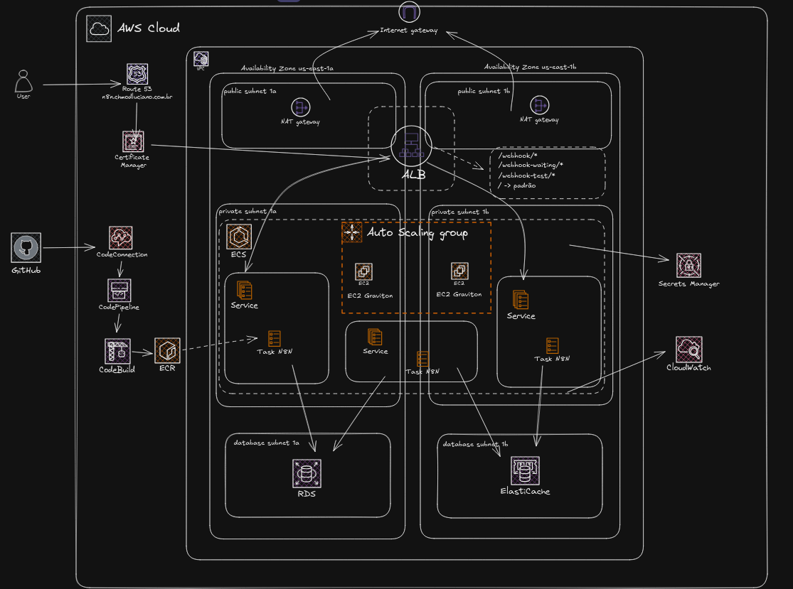

# AWS ECS — n8n em queue mode

Laboratório Terraform para executar o n8n sobre um grupo com duas EC2 Graviton iniciais, com serviços separados de main, webhook e worker. RDS PostgreSQL armazena workflows e execuções; ElastiCache Valkey mantém a fila interna. CodePipeline recebe o código do GitHub, CodeBuild constrói as imagens ARM64 e entrega pelo ECR.

## Arquitetura



O ALB público distribui o acesso entre main e webhook. As EC2 e tasks ficam em duas subnets privadas, com saída por um NAT Gateway em cada AZ. RDS e Valkey usam duas subnets isoladas. A VPC é criada aqui mesmo.

| Componente | Configuração do sandbox |
| --- | --- |
| ECS sobre EC2 | Inicialmente duas `t4g.small`, ASG com mínimo 2 e máximo 4 |
| Main | Uma task após o bootstrap, para interface, API e triggers |
| Webhook | Uma task após o bootstrap, para webhooks de produção |
| Worker | Uma task após o bootstrap, para executar os workflows |
| Banco | RDS PostgreSQL `18.6`, `db.t4g.micro`, Single-AZ |
| Fila | ElastiCache Valkey `8.2`, `cache.t4g.micro`, sem réplica |
| Saída | Dois NAT Gateways: um na subnet pública 1a e outro na 1b |
| Entrada | ALB público, ACM e `n8n.chmodluciano.com.br` |

Os três serviços usam a mesma imagem, com os comandos `start`, `webhook` e `worker`. O worker executa workflows; não há container auxiliar nem segunda imagem de aplicação.

Main permanece único: seu deploy encerra a task anterior antes de iniciar a próxima. Há uma interrupção temporária da interface e dos triggers desse processo. Webhook e worker têm serviços e task definitions próprios. Não há SQS, multi-main, WAF ou Lambda.

A retenção de backups do RDS é configurada por `rds_backup_retention_period`, com um dia no sandbox. O banco usa a família `postgres18` e o Valkey usa `valkey8`.

O ASG escala os hosts por meio do Capacity Provider e pode aumentar a quantidade de EC2 durante deployments ou quando faltar capacidade para as tasks. As quantidades de tasks são informadas em `main_count`, `webhook_count` e `worker_count`. Não há auto scaling desses serviços. As reservas iniciais de memória são 768 MiB para main, 512 MiB para webhook e 1.024 MiB para worker. Ajuste conforme a carga dos workflows.

O Capacity Provider usa o nome `capacity-aws-ecs-n8n-ec2`, pois esse recurso não aceita nomes iniciados por `aws`, `ecs` ou `fargate`.

As duas rotas privadas usam o NAT da própria zona: privada 1a → NAT 1a → pública 1a; privada 1b → NAT 1b → pública 1b. As subnets de dados permanecem sem rota para a internet.

| Rede | CIDR |
| --- | --- |
| VPC | `10.0.0.0/16` |
| Privada 1a | `10.0.0.0/20` |
| Privada 1b | `10.0.16.0/20` |
| Pública 1a | `10.0.48.0/24` |
| Pública 1b | `10.0.49.0/24` |
| Dados 1a | `10.0.51.0/24` |
| Dados 1b | `10.0.52.0/24` |

## Estrutura

Os arquivos Terraform ficam na raiz e compartilham provider, backend e estado. `variables.tf` contém apenas os nomes das variáveis. Todos os valores de entrada estão em `live/sandbox/terraform.tfvars`. Os CIDRs são definidos nos recursos de rede. Os recursos usam `project_name` na nomenclatura e tags `Name`, `Environment` e `Terraform`.

| Arquivos | Responsabilidade |
| --- | --- |
| `vpc.tf`, `internet_gateway.tf`, `*_subnets.tf`, `nat_gateway.tf` | VPC, subnets e rotas |
| `ecs_cluster.tf`, `ecs_iam.tf`, `ecs_service.tf` | EC2, ASG, Capacity Provider, IAM e serviços |
| `ecs_main_task_definition.tf`, `ecs_webhook_task_definition.tf`, `ecs_worker_task_definition.tf` | Definição de cada papel do n8n |
| `rds.tf`, `elasticache.tf`, `secrets_manager.tf` | Banco, fila e segredos |
| `alb.tf`, `route53.tf`, `security_group.tf` | HTTPS, domínio e regras de rede |
| `codebuild*.tf`, `codepipeline*.tf`, `ecr.tf`, `buildspec.yml` | Build e entrega |
| `templates/ecs_user_data.sh.tftpl` | Configuração do agente ECS nas EC2 |

O build fica inteiro no `buildspec.yml`: autenticação no ECR, build ARM64, push e geração dos arquivos de imagem usados pelo CodePipeline. O Terraform lê esse arquivo local com `file()` e envia seu conteúdo ao projeto CodeBuild durante o apply. O CodeBuild usa o YAML armazenado na configuração do projeto, sem buscar o buildspec no código recebido do GitHub. Alterações no buildspec exigem terraform apply; alterações no Dockerfile exigem commit e push, pois ele continua vindo do Source. Durante o build, o Dockerfile baixa diretamente da AWS a cadeia pública de certificados do RDS para dentro da imagem. Não há diretório de certificados no repositório, scripts ou sincronização externa de task definitions.

## Custos

Este laboratório cria recursos cobrados pela AWS, inclusive quando os serviços ECS estão com zero tasks. Considere EC2, EBS, ALB, dois NAT Gateways, IPv4 público, RDS, ElastiCache, Route 53, Secrets Manager, armazenamento, logs e execuções do pipeline.

Free Tier e créditos dependem da conta e não garantem gratuidade da arquitetura. Confira as cotas, as versões disponíveis e as condições da sua conta na região escolhida antes do apply. Remova o laboratório quando terminar os testes.

## Preparar

São necessários Terraform 1.11 ou superior, AWS CLI atualizada e acesso ao repositório GitHub. O build padrão roda no CodeBuild; Docker local só é necessário para builds manuais.

```bash
export AWS_PROFILE=seu-profile
export AWS_REGION=us-east-1
export AWS_DEFAULT_REGION=us-east-1
aws sts get-caller-identity
```

Configure seu profile AWS e ajuste região, domínio, repositório e branch em `live/sandbox/terraform.tfvars`. A branch informada em `source_branch` deve existir no GitHub e conter o Dockerfile. Para usar a branch principal após o merge, informe `source_branch = "main"`.

Preencha o bucket em `live/sandbox/backend.tfvars`. Ele deve existir, com versionamento, bloqueio público e permissões restritas. O estado contém segredos gerados pelo Terraform; precisa ser protegido. O bucket de artefatos do pipeline é separado e criado por este projeto.

```bash
terraform init -backend-config=live/sandbox/backend.tfvars
terraform fmt -check -recursive
terraform validate
```

Na primeira implantação, mantenha `image_tag = "bootstrap"` e as três contagens em zero:

```hcl
image_tag     = "bootstrap"
main_count    = 0
webhook_count = 0
worker_count  = 0
```

`bootstrap` é apenas um valor inicial; não é uma imagem criada automaticamente no ECR. As tasks só devem ser iniciadas depois que o CodeBuild publicar a primeira imagem e você atualizar `image_tag`.

## Preparar o domínio

O fluxo definido usa HTTPS com `n8n.chmodluciano.com.br`. `dns_zone_name = "chmodluciano.com.br"` cria a zona do domínio inteiro no Route 53; `domain_name = "n8n.chmodluciano.com.br"` define o endereço da aplicação. O registro do domínio permanece no Registro.br, e o Route 53 passa a administrar o DNS. Substitua esses valores pelo seu domínio. Se já houver serviços no domínio, preserve os registros existentes ao mudar os servidores DNS.

Se a zona já existe, importe-a antes de aplicar, substituindo `ID_DA_ZONA` pelo ID da sua hosted zone:

```bash
terraform import --var-file=live/sandbox/terraform.tfvars aws_route53_zone.n8n ID_DA_ZONA
```

Importe também os registros A e CNAME se eles já existirem. Uma zona que contém somente NS e SOA exige apenas o import da zona.

Se a zona ainda não existe, crie apenas a zona para obter seus nameservers antes de validar o certificado:

```bash
terraform plan --var-file=live/sandbox/terraform.tfvars -target=aws_route53_zone.n8n
terraform apply --var-file=live/sandbox/terraform.tfvars -target=aws_route53_zone.n8n
terraform output -json domain_name_servers
```

Os quatro servidores retornados são gerados pela AWS; não vêm do e-mail de compra do domínio. Na tela inicial do Route 53, não é necessário registrar, transferir ou criar outra zona manualmente: o Terraform cria a zona.

No Registro.br, entre na conta, selecione `chmodluciano.com.br` e abra DNS → Alterar servidores DNS. Informe os quatro nomes retornados, um por campo, adicionando campos se necessário, e salve. São nomes de servidores, não endereços IP. Essa etapa substitui os servidores DNS do domínio inteiro pelos servidores da zona raiz criada acima. Não use os servidores de uma zona criada apenas para `n8n.chmodluciano.com.br`.

```bash
dig +short NS chmodluciano.com.br
```

Depois de confirmar a delegação, aplique o projeto completo. O uso de `-target` acima é apenas para essa preparação inicial; as aplicações seguintes usam o projeto inteiro.

```bash
terraform plan --var-file=live/sandbox/terraform.tfvars
terraform apply --var-file=live/sandbox/terraform.tfvars
```

ACM aguarda a validação DNS. O listener HTTP redireciona para HTTPS. O listener HTTPS encaminha para main e a regra de caminhos `/webhook/*` e `/webhook-waiting/*` encaminha para webhook. `/webhook-test/*`, interface e API seguem para main.

## GitHub e primeira entrega

```bash
terraform output -raw github_connection_arn
terraform output -raw pipeline_name
```

No console AWS, abra Developer Tools → Settings → Connections e conclua a autorização GitHub da conexão criada. Ela precisa passar de `PENDING` para `AVAILABLE`. Essa autorização é feita no GitHub e não é concluída pelo Terraform. A execução automática inicial da pipeline pode falhar enquanto a conexão estiver pendente.

Envie o código para a branch configurada. O Terraform não faz o push. Depois da autorização, inicie o pipeline pelo console ou pela CLI:

```bash
aws codepipeline start-pipeline-execution --name "$(terraform output -raw pipeline_name)"
```

A entrega segue Source → Build → Deploy. O estágio Deploy atualiza main, webhook e worker em paralelo, com uma ação para cada serviço ECS. A entrega não é uma transação única dos três serviços.

O CodeBuild usa a imagem oficial `ghcr.io/n8n-io/n8n`, na versão definida por `n8n_version`, para construir a imagem ARM64 publicada no ECR e compartilhada pelos serviços main, webhook e worker. A imagem base vem do GHCR; a imagem construída para o projeto fica no ECR da sua conta. A tag publicada no ECR combina commit e número do build, por exemplo `a1b2c3d4e5f6-1`. Ela aparece nos logs e no artefato `release.json`. Imagens são imutáveis, sem `latest`.

### Atualizar a tag e iniciar as tasks

**Após o CodeBuild publicar a imagem, atualize `image_tag` em `live/sandbox/terraform.tfvars` com a tag exata do ECR. Faça isso antes do apply que inicia as tasks.**

`n8n_version` seleciona a versão da imagem base, por exemplo `2.44.6`. `image_tag` identifica a imagem construída pelo projeto, por exemplo `a1b2c3d4e5f6-1`; são valores diferentes.

Encontre a tag nos logs do CodeBuild, no artefato `release.json` ou no console ECR. Pela CLI, consulte as imagens publicadas, substituindo o nome do repositório caso tenha alterado `project_name`:

```bash
aws ecr describe-images \
  --repository-name aws-ecs-n8n/n8n \
  --query 'sort_by(imageDetails, &imagePushedAt)[].{Tags:imageTags,PublicadaEm:imagePushedAt}' \
  --output table
```

Após a primeira pipeline concluir, substitua o valor de exemplo abaixo pela tag da entrega que deseja executar e inicie uma task por serviço:

```hcl
image_tag     = "a1b2c3d4e5f6-1" # Substitua pela tag real publicada no ECR.
main_count    = 1
webhook_count = 1
worker_count  = 1
```

```bash
terraform plan --var-file=live/sandbox/terraform.tfvars
terraform apply --var-file=live/sandbox/terraform.tfvars
terraform output -raw n8n_url
```

Abra a URL e crie o usuário proprietário. Mantenha `main_count = 1`; este projeto não usa multi-main.

## Entregas seguintes

O pipeline publica revisões das task definitions para atualizar imagens. Depois de cada entrega concluída, registre a tag publicada em `image_tag`. Terraform também gerencia essas definições e as referências dos serviços. **Antes de cada novo apply, atualize `image_tag` com a última tag entregue pelo pipeline.** Isso mantém a configuração declarada alinhada à imagem em execução. Se informar uma tag anterior, Terraform voltará os serviços para aquela imagem.

Mudanças de ambiente, memória, CPU e segredos são feitas pelo próprio Terraform, sem script de sincronização. Confira o plano antes de aplicar. A troca da revisão do main interrompe temporariamente a interface.

Ao mudar `n8n_version`, aplique a configuração do CodeBuild mantendo a tag atual, execute o pipeline e registre a nova tag em `terraform.tfvars`. A versão é passada como build argument ao Dockerfile. Atualizações podem executar migrações de banco: faça backup e consulte as notas da versão. Rollback de imagem não desfaz migrações. Versões incompatíveis entre processos precisam de atualização coordenada com execuções interrompidas.

## Operação e segurança

As EC2 usam AMI ECS Optimized Amazon Linux 2023 ARM64, IMDSv2, EBS criptografado e Session Manager, sem SSH. Tasks recebem segredos pelo execution role; o task role não concede acesso AWS aos workflows. O ALB fica público. ALB → task usa HTTP privado; banco e fila usam TLS.

O Dockerfile obtém a cadeia pública de certificados do [trust store oficial do RDS](https://truststore.pki.rds.amazonaws.com/global/global-bundle.pem) e a inclui em `/opt/certs/global-bundle.pem`, dentro da imagem. `DB_POSTGRESDB_SSL_CA_FILE` fornece essa cadeia diretamente à configuração PostgreSQL do n8n, permitindo validar o certificado do banco. A conexão continua com `DB_POSTGRESDB_SSL_REJECT_UNAUTHORIZED=true`.

Os certificados do host EC2 e do ambiente CodeBuild não são automaticamente compartilhados com o container. O arquivo é obtido durante o build, sem manutenção de uma cópia no repositório. Não contém chave privada e não substitui o certificado ACM usado no ALB. Para atualizar a cadeia, reconstrua a imagem sem reutilizar a camada em cache e faça uma nova entrega.

O laboratório usa o administrador gerenciado do RDS para simplificar a inicialização. Para uso permanente, prepare um usuário exclusivo com permissões para migrações. RDS administra a senha; tasks recebem o valor no início e precisam ser reiniciadas após rotação. Preserve a chave de criptografia de instalações existentes.

```bash
aws logs tail /ecs/aws-ecs-n8n/worker --follow
aws ecs describe-services \
  --cluster "$(terraform output -raw ecs_cluster_name)" \
  --services aws-ecs-n8n-main aws-ecs-n8n-webhook aws-ecs-n8n-worker
```

Logs mostram o processo e seus erros; o nível padrão não garante uma linha por execução. Consulte o histórico do n8n para os resultados. Container Insights está desabilitado.

Workflows que acessam portas externas além de HTTP/HTTPS precisam das regras de saída correspondentes. Arquivos persistentes exigem armazenamento compatível com queue mode e com a licença. O disco local das tasks não é persistência compartilhada. Os workflows são criados na interface do n8n; o repositório contém a infraestrutura e a configuração de build.

## Validação local

```bash
terraform fmt -check -recursive
terraform validate
```

O uso da configuração correta e a revisão dos valores ficam com quem executa o laboratório; não há tipos, defaults ou validações em `variables.tf`.

## Retomar um apply interrompido

Um erro não desfaz os recursos já criados. Corrija a causa e gere outro plano antes de repetir o apply.

Se o ASG apresentar uma falha inicial de lançamento, confira suas atividades e as EC2: o grupo pode conseguir iniciá-las em uma tentativa automática posterior. Se as instâncias estiverem saudáveis e registradas no ECS, mas o plano indicar `aws_autoscaling_group.ecs is tainted`, remova somente essa marca do estado:

```bash
terraform untaint aws_autoscaling_group.ecs
terraform plan --var-file=live/sandbox/terraform.tfvars
```

O `untaint` não altera as instâncias. Use-o somente depois de confirmar que o recurso está funcionando. Confira que o novo plano não substitui o ASG antes de continuar com o apply.

## Remoção

O destroy é executado manualmente pelo responsável pelo laboratório. Pare novas entregas e espere os workflows terminarem. Se habilitou `deletion_protection`, desabilite e aplique antes da remoção.

As dependências mantêm rotas, associações das subnets, NATs, saída HTTPS dos hosts e permissões IAM disponíveis até os serviços e as EC2 encerrarem. As regras de banco, fila, APIs externas e ALB também permanecem até a exclusão dos serviços que as utilizam. A ordem do destroy é inversa à criação: serviços ECS → capacity provider e ASG → rede. Não remova regras ou rotas manualmente enquanto as tasks estiverem encerrando.

Neste laboratório, `skip_final_snapshot = true` evita snapshot final do RDS e `recovery_window_in_days = 0` solicita exclusão definitiva dos segredos. ECR e bucket de artefatos são esvaziados. O bucket compartilhado do estado permanece. Essas configurações precisam estar aplicadas antes da remoção de uma instalação antiga; editar os arquivos e executar somente destroy pode continuar usando os valores anteriores do estado. A exclusão definitiva dos segredos é assíncrona na AWS e pode levar algum tempo para liberar os nomes.

### Preservar o Route 53

O destroy completo também exclui a zona e os registros DNS. Para preservar todos eles, salve o estado fora do repositório e retire somente os três recursos Route 53 do estado antes de gerar o plano de remoção:

```bash
export AWS_PROFILE=seu-profile
export AWS_REGION=us-east-1

terraform state pull > /tmp/aws-ecs-n8n-before-destroy.tfstate
chmod 600 /tmp/aws-ecs-n8n-before-destroy.tfstate

terraform state rm aws_route53_zone.n8n aws_route53_record.certificate aws_route53_record.n8n
terraform plan -destroy --var-file=live/sandbox/terraform.tfvars
terraform destroy --var-file=live/sandbox/terraform.tfvars
```

Confira que o plano não contém recursos `aws_route53_*`. O `state rm` não exclui os recursos da AWS, mas deixa o DNS sem gerenciamento por esse estado. Não execute apply normal depois disso sem importar novamente a zona e os registros existentes. O registro A preservado aponta para o ALB excluído até a próxima implantação. Os nameservers cadastrados no Registro.br permanecem iguais.

Após o destroy, confira se ficaram snapshots manuais, segredos em recuperação ou volumes de execuções anteriores. Recursos já retirados do estado não são removidos por outro destroy.

O capacity provider pode continuar visível como `INACTIVE`; isso é um registro inativo do serviço, não capacidade EC2 em execução. EC2 encerradas e NATs excluídos também podem aparecer temporariamente nas consultas históricas.

## Referências

- [Queue mode n8n](https://docs.n8n.io/deploy/host-n8n/configure-n8n/scaling/enable-queue-mode.md)
- [Capacity Providers EC2](https://docs.aws.amazon.com/AmazonECS/latest/developerguide/asg-capacity-providers.html)
- [Deploy ECS no CodePipeline](https://docs.aws.amazon.com/codepipeline/latest/userguide/action-reference-ECS.html)

## Licença

Distribuído sob a licença MIT. Consulte [LICENSE](LICENSE).
